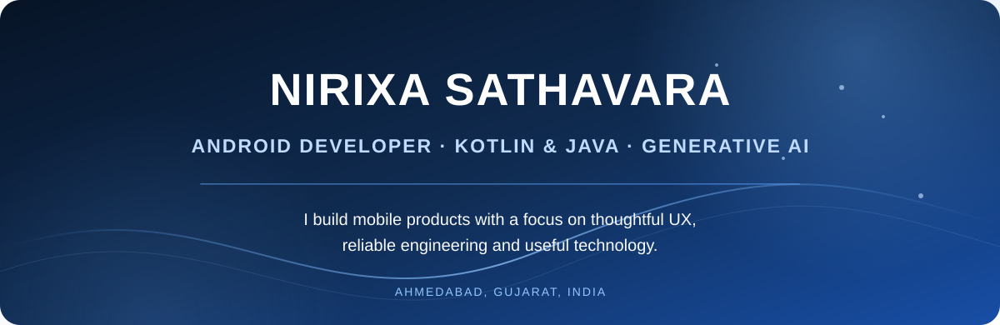

<!-- Premium Blue GitHub Profile README | Nirixa Sathavara -->

  

<table width="100%" cellpadding="14" cellspacing="0" bgcolor="#102C52">
  <tr>
    <td align="center" bgcolor="#102C52">
      
      &nbsp;&nbsp;
      
      &nbsp;&nbsp;
      
    </td>
  </tr>
</table>

---

## 👋 About Me

I'm a Computer Engineering graduate and Android developer interested in building and shipping mobile products. I enjoy working across the product journey—from understanding an idea and shaping its interface to implementation, testing and release.

- 📱 **Android Engineering:** Kotlin, Java, Android SDK and Android Studio
- 🎨 **Product & UI:** usability, interface design and app quality
- 🤖 **Applied AI:** Gemini, Imagen and Vertex AI
- ☁️ **Services & Data:** Firebase, REST APIs, SQL and MySQL

## 🚀 Featured Project

### ⚡ DevPulse AI

**AI-assisted developer productivity · Workflow intelligence**

An AI-powered project concept focused on helping developers make sense of their work and improve everyday development workflows.

Submitted to the <b>Build, Ship, Shape: Amazon Developer Hackathon</b>

**Project focus**

- Developer productivity and workflow intelligence
- Applying generative AI to practical developer workflows
- Exploring ways to make development work more organized and actionable

---

## 📲 Published Android Applications

| Application | Overview | |
|:--|:--|:--:|
| **Mahabali Panchmukhi Hanuman** | Devotional mobile experience | [Google Play ↗](https://play.google.com/store/apps/details?id=nirixa.crystal.sathavara) |
| **PDF Editor, Scanner & AI Sign** | PDF and document productivity | [Google Play ↗](https://play.google.com/store/apps/details?id=pdf.docucraft.sign.pro) |
| **Crossy Road: Traffic Run** | 3D arcade-style gameplay | [Google Play ↗](https://play.google.com/store/apps/details?id=crosser.road.cross) |
| **Tic Tac Toe: Shiva X Rock** | Strategy board game | [Google Play ↗](https://play.google.com/store/apps/details?id=nirixa.shiva_rock.sathavara) |

  <a href="https://play.google.com/store/apps/developer?id=Nirixa+Sathavara"><b>EXPLORE ALL APPS ON GOOGLE PLAY →</b></a>

## 🧰 Technical Skills

| **Category** | **Technologies** |
|:--|:--|
| **Languages** |  |
| **Android & UI** |  |
| **Backend & Tools** |  |
| **AI & Cloud** |     |

## 💼 Professional Experience

**Android Developer**  
Wealthstreet Financial Services Private Limited  
June 2022 – September 2022

**Android Developer Intern**  
Way To Web Pvt Ltd  
June 2018 – April 2019

## 🎓 Education

**Bachelor of Engineering — Computer Engineering**  
Gujarat Technological University · 2015–2019

## 🏅 Certifications

- Google Cloud Skills Boost — Prompt Design in Vertex AI
- Google Cloud Skills Boost — Build Real World AI Applications with Gemini and Imagen
- Android Development Certification — Way To Web Pvt Ltd
- MEAN Stack Certification — GUJCOST
- Digital Marketing Certification — Google
- Cyber Security & Women Safety Certification — Halla Bol Season 2

## 🤝 Connect With Me

---

  <b>BUILD WITH PURPOSE · ENGINEER WITH CARE · KEEP LEARNING</b>
    
  

